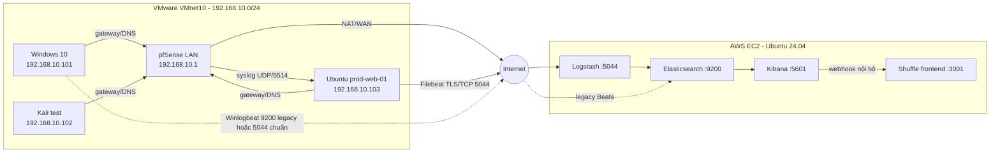
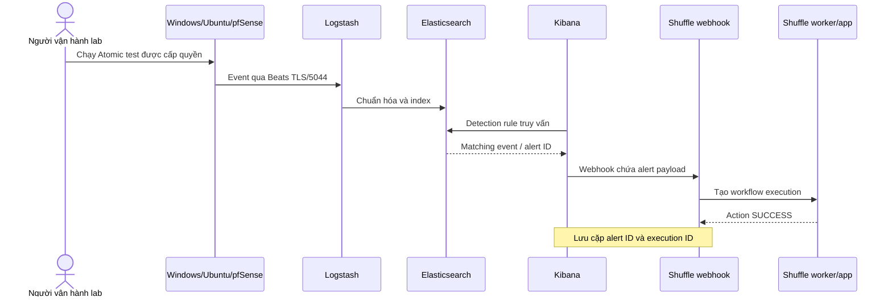
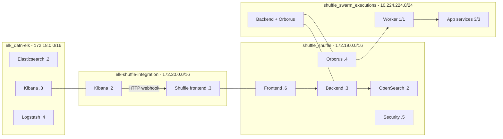

# Kiểm kê cấu hình, mạng và vận hành hệ thống DATN

> Cập nhật: 22/10/2026 (ICT)
>
> Phạm vi: VMware lab, pfSense, Ubuntu relay/web, Windows endpoint, AWS EC2, ELK 9.5.4 và Shuffle SOAR
>
> Trạng thái: cấu hình hạ tầng đã gần hoàn tất; detection rule, connector/webhook, playbook nghiệp vụ và dashboard còn phải xây dựng
>
> Bảo mật: tài liệu này an toàn để commit công khai. Mật khẩu, token, private key và encryption key thật không xuất hiện trong file.

## 1. Đọc nhanh trước khi vận hành

Các luồng telemetry đã từng được kiểm thử thành công. Khi VM Windows, Ubuntu hoặc pfSense tắt thì không có log mới; trạng thái đó không được coi là lỗi pipeline. Trước demo chỉ cần bật VM và xác nhận timestamp mới.

Các điểm đã đạt:

| Hạng mục | Trạng thái | Bằng chứng chính |
|---|---|---|
| Ubuntu → Filebeat → Logstash → Elasticsearch | Đạt | `datn-ubuntu-*` có dữ liệu; TLS/5044 từng được xác nhận |
| pfSense → Ubuntu relay → ELK | Đạt ở mức lab | `datn-pfsense-2026.10.22` có document; đường UDP/5514 đã cấu hình |
| Windows/Winlogbeat và Linux/Auditbeat | Đã có dữ liệu | data stream Winlogbeat/Auditbeat tồn tại trong Elasticsearch |
| Kibana Actions/Rules API | Đạt | `/api/actions/connectors` và `/api/alerting/rules/_find` trả HTTP 200 |
| Shuffle worker/app runtime | Đạt | worker `1/1`, app service `3/3` |
| Shuffle Manual workflow | Đạt | workflow `FINISHED`, action `SUCCESS` |
| Kibana alert → Shuffle webhook | Chưa triển khai | hiện chưa có connector/rule/webhook workflow nghiệp vụ |

Trước khi tạo connector có credential, phải đặt `SHUFFLE_ENCRYPTION_MODIFIER`. Backend hiện báo biến này trống. Giá trị phải là chuỗi ngẫu nhiên ổn định và không được đổi sau khi đã mã hóa authentication.

## 2. Kiến trúc tổng thể

Nguồn chỉnh sửa của sơ đồ: [`diagrams/network-topology.mmd`](../diagrams/network-topology.mmd).



Luồng nghiệp vụ cần hoàn thiện:



## 3. Kế hoạch địa chỉ và vai trò

### 3.1 VMware lab

| Thiết bị | Hệ điều hành/vai trò | Địa chỉ | Gateway/DNS | Ghi chú |
|---|---|---:|---:|---|
| pfSense | Router, NAT, DHCP, firewall, syslog source | `192.168.10.1/24` | chính nó | LAN VMnet10 |
| Windows 10 | Endpoint chính, Atomic Red Team, Winlogbeat | `192.168.10.101/24` | `192.168.10.1` | IP đã quan sát qua DHCP |
| Kali | Máy tạo lưu lượng/kiểm tra lab | `192.168.10.102/24` | `192.168.10.1` | không phải agent production |
| Ubuntu `prod-web-01` | Web server, Filebeat, rsyslog relay | `192.168.10.103/24` | `192.168.10.1` | nên tạo DHCP static mapping |

Subnet đang chạy là `192.168.10.0/24`. Không dùng lại subnet `10.100.0.0/24` xuất hiện trong tài liệu cũ.

### 3.2 AWS EC2

| Thuộc tính | Giá trị đã xác minh |
|---|---|
| Instance profile | `m7i-flex.large`, 2 vCPU, khoảng 8 GiB RAM, EBS khoảng 80 GB |
| OS | Ubuntu 24.04.5 LTS |
| Timezone | `Asia/Ho_Chi_Minh` |
| Private IPv4 | `172.31.44.226/20` |
| Default gateway | `172.31.32.1` |
| Public endpoint | Elastic IP được lưu trong inventory riêng; cấu hình Filebeat triển khai hiện dùng endpoint này |
| SSH user | `ubuntu` |
| Docker | Compose cho ELK/Shuffle và Swarm một node cho Shuffle runtime |

### 3.3 Docker networks



| Network | Driver/scope | Thành viên chính | Mục đích |
|---|---|---|---|
| `elk_datn-elk` | bridge/local | Elasticsearch, Kibana, Logstash | lưu trữ, tìm kiếm và ingest |
| `shuffle_shuffle` | bridge/local | frontend, backend, OpenSearch, Orborus, Security | control plane Shuffle |
| `elk-shuffle-integration` | bridge/local, external | Kibana, Shuffle frontend | connector gọi webhook nội bộ |
| `shuffle_swarm_executions` | overlay/swarm, attachable | backend, Orborus, worker, app services | execution runtime |
| `docker_gwbridge` | bridge/local | Swarm tasks | gateway cho overlay |

Không dùng IP container cố định trong connector. Dùng DNS service/container, ví dụ `http://shuffle-frontend/api/v1/hooks/<HOOK_ID>`.

## 4. Ma trận cổng và phạm vi truy cập

| Port/protocol | Nguồn → đích | Chức năng | Phạm vi khuyến nghị |
|---|---|---|---|
| `22/TCP` | máy quản trị → EC2 | SSH | IP quản trị `/32` hoặc VPN |
| `22/TCP` | VMnet10 → Ubuntu | SSH Ubuntu | chỉ `192.168.10.0/24` |
| `53/TCP,UDP` | VM lab → pfSense | DNS resolver | chỉ LAN |
| `67/68/UDP` | VM lab ↔ pfSense | DHCP | chỉ VMnet10 |
| `80/443/TCP` | LAN admin → pfSense | WebGUI | chỉ LAN quản trị; ưu tiên HTTPS |
| `80/TCP` | client lab → Ubuntu | Nginx/Flaskr | theo phạm vi demo |
| `5514/UDP` | pfSense → Ubuntu | remote syslog | chỉ nguồn `192.168.10.1` |
| `5044/TCP` | Beats → EC2 Logstash | TLS log ingest | chỉ public egress IP lab `/32` |
| `5601/TCP` | analyst → Kibana | UI/API | IP quản trị `/32` hoặc tunnel |
| `9200/TCP` | nội bộ/legacy Beats → Elasticsearch | REST/data | không mở Internet rộng; đường trực tiếp chỉ là ngoại lệ |
| `9600/TCP` | admin → Logstash | monitoring API | nội bộ/tunnel |
| `3001/TCP` | analyst → Shuffle frontend | Shuffle HTTP UI | IP quản trị/tunnel |
| `3443/TCP` | analyst → Shuffle frontend | Shuffle HTTPS UI | IP quản trị/tunnel |
| `5001/TCP` | frontend/admin → Shuffle backend | backend API | ưu tiên Docker network/tunnel |
| `9201/TCP` | backend/admin → Shuffle OpenSearch | OpenSearch API | không mở Internet rộng |
| `3002/3444` | analyst → Shuffle Security | Shuffle Security UI | IP quản trị/tunnel |
| `2377/TCP` | Swarm manager | Swarm control | một node: không cần mở ra Internet |
| `7946/TCP,UDP` | Swarm nodes | discovery/gossip | chỉ cần nếu bổ sung node |
| `4789/UDP` | Swarm nodes | VXLAN overlay | chỉ cần giữa các node Swarm |

## 5. Cấu hình pfSense

### 5.1 LAN, DHCP và NAT

- LAN: `192.168.10.1/24` trên VMnet10.
- DHCP cấp các endpoint trong `192.168.10.0/24`.
- Gateway và DNS DHCP: `192.168.10.1`.
- WAN dùng mạng NAT VMware; pfSense NAT lưu lượng VM ra Internet.
- Nên tạo static mapping cho Windows `.101`, Kali `.102` và Ubuntu `.103` để sơ đồ và rule không đổi sau reboot.

### 5.2 Remote Logging

Trong WebGUI vào `Status → System Logs → Settings → Remote Logging Options`:

| Trường | Giá trị |
|---|---|
| Enable Remote Logging | bật |
| Source Address | LAN / `192.168.10.1` |
| IP Protocol | IPv4 |
| Remote Log Server | `192.168.10.103:5514` |
| Remote Syslog Contents | System Events và Firewall Events; có thể chọn Everything khi kiểm thử |

Nhấn Save và Apply Changes. Với rule firewall cần quan sát, bật `Log packets that are handled by this rule`. Không bật logging trên mọi rule lưu lượng lớn trong thời gian dài.

Kiểm tra từ Ubuntu:

```bash
sudo tcpdump -ni ens33 'udp port 5514 and host 192.168.10.1'
sudo tail -f /var/log/pfsense.log
```

Kết quả đạt: packet có source `192.168.10.1`, file có dòng mới chứa hostname pfSense hoặc `filterlog`, và Elasticsearch nhận document trong `datn-pfsense-*`.

## 6. Cấu hình Ubuntu relay và web agent

### 6.1 Host và dịch vụ

| Thuộc tính | Giá trị |
|---|---|
| Hostname | `prod-web-01` |
| OS quan sát | Ubuntu 22.04.5 LTS |
| Interface | `ens33` |
| IPv4 | `192.168.10.103/24` |
| Gateway | `192.168.10.1` |
| Dịch vụ | Nginx, Gunicorn/Flaskr, rsyslog, Filebeat 9.5.4 |
| Web | Nginx `0.0.0.0:80` → Gunicorn `127.0.0.1:8000` |

UFW tối thiểu:

```bash
sudo ufw allow from 192.168.10.0/24 to any port 22 proto tcp comment 'SSH from lab LAN'
sudo ufw allow 80/tcp comment 'Nginx HTTP'
sudo ufw allow from 192.168.10.1 to any port 5514 proto udp comment 'pfSense syslog'
sudo ufw enable
sudo ufw status numbered
```

### 6.2 rsyslog relay

File `/etc/rsyslog.d/30-pfsense.conf`:

```rsyslog
module(load="imudp")

template(name="pfSenseRaw" type="string" string="%rawmsg%\n")

ruleset(name="pfSenseRemote") {
  action(
    type="omfile"
    file="/var/log/pfsense.log"
    template="pfSenseRaw"
    fileCreateMode="0640"
    fileOwner="syslog"
    fileGroup="adm"
  )
  stop
}

input(type="imudp" port="5514" ruleset="pfSenseRemote")
```

Áp dụng và kiểm tra:

```bash
sudo rsyslogd -N1
sudo systemctl enable --now rsyslog
sudo ss -lunp | grep ':5514 '
sudo stat /var/log/pfsense.log
```

### 6.3 Filebeat

Nguồn version-control: [`elk/filebeat/filebeat.yml`](../elk/filebeat/filebeat.yml).

```yaml
filebeat.inputs:
  - type: filestream
    id: ubuntu-system
    enabled: true
    paths: [/var/log/syslog, /var/log/auth.log]
    fields:
      log_source: ubuntu

  - type: filestream
    id: ubuntu-nginx
    enabled: true
    paths:
      - /var/log/nginx/flaskr_access.log
      - /var/log/nginx/flaskr_error.log
    fields:
      log_source: ubuntu

  - type: filestream
    id: pfsense-relay
    enabled: true
    paths: [/var/log/pfsense.log]
    fields:
      log_source: pfsense

processors:
  - add_host_metadata: ~

output.logstash:
  hosts: ["<EC2_PUBLIC_ENDPOINT>:5044"]
  ssl.certificate_authorities:
    - /etc/filebeat/certs/ca.crt
```

Triển khai CA ở `/etc/filebeat/certs/ca.crt`, quyền đọc root/Filebeat và kiểm tra:

```bash
sudo filebeat test config -e
sudo filebeat test output -e
sudo systemctl enable --now filebeat
sudo journalctl -u filebeat -n 60 --no-pager
```

## 7. Cấu hình Windows endpoint

### 7.1 Trạng thái và đường gửi

| Thuộc tính | Giá trị/ghi chú |
|---|---|
| OS | Windows 10 VM |
| IPv4 | `192.168.10.101/24` |
| Gateway/DNS | `192.168.10.1` |
| Agent đã có dữ liệu | Winlogbeat 9.4.5 |
| Index/data stream lịch sử | `.ds-winlogbeat-9.4.5-*` |
| Đường lịch sử | gửi trực tiếp Elasticsearch `9200/TCP` theo ngoại lệ tạm thời |
| Đường chuẩn của đồ án | Winlogbeat → Logstash TLS `5044/TCP` → `datn-windows-*` |

Repository chưa có bản export nguyên gốc `winlogbeat.yml`, Sysmon config và GPO của guest. Không được tuyên bố các cấu hình đó đã được version-control cho đến khi export từ VM. Phần dưới là baseline chuẩn để đối chiếu/triển khai lại.

### 7.2 PowerShell logging

Chạy PowerShell với quyền Administrator:

```powershell
$base = 'HKLM:\Software\Policies\Microsoft\Windows\PowerShell'
New-Item "$base\ModuleLogging" -Force | Out-Null
New-Item "$base\ModuleLogging\ModuleNames" -Force | Out-Null
New-ItemProperty "$base\ModuleLogging" -Name EnableModuleLogging -Value 1 -PropertyType DWord -Force | Out-Null
New-ItemProperty "$base\ModuleLogging\ModuleNames" -Name '*' -Value '*' -PropertyType String -Force | Out-Null

New-Item "$base\ScriptBlockLogging" -Force | Out-Null
New-ItemProperty "$base\ScriptBlockLogging" -Name EnableScriptBlockLogging -Value 1 -PropertyType DWord -Force | Out-Null

New-Item "$base\Transcription" -Force | Out-Null
New-ItemProperty "$base\Transcription" -Name EnableTranscripting -Value 1 -PropertyType DWord -Force | Out-Null
New-ItemProperty "$base\Transcription" -Name EnableInvocationHeader -Value 1 -PropertyType DWord -Force | Out-Null
New-ItemProperty "$base\Transcription" -Name OutputDirectory -Value 'C:\ProgramData\PowerShellTranscripts' -PropertyType String -Force | Out-Null
```

Event quan trọng cho `T1059.001`: PowerShell Operational `4103`, `4104`; process creation Security `4688`; Sysmon Process Create `1` nếu Sysmon được cài.

### 7.3 Winlogbeat baseline qua Logstash

```yaml
winlogbeat.event_logs:
  - name: Security
  - name: System
  - name: Application
  - name: Microsoft-Windows-PowerShell/Operational
  - name: Windows PowerShell
  - name: Microsoft-Windows-Sysmon/Operational
    ignore_older: 72h

fields:
  log_source: windows

processors:
  - add_host_metadata: ~

output.logstash:
  hosts: ["<EC2_PUBLIC_ENDPOINT>:5044"]
  ssl.certificate_authorities:
    - C:/ProgramData/winlogbeat/certs/ca.crt
```

Kiểm tra trên Windows:

```powershell
Get-Service winlogbeat
& 'C:\Program Files\Winlogbeat\winlogbeat.exe' test config -c 'C:\Program Files\Winlogbeat\winlogbeat.yml' -e
& 'C:\Program Files\Winlogbeat\winlogbeat.exe' test output -c 'C:\Program Files\Winlogbeat\winlogbeat.yml' -e
Test-NetConnection <EC2_PUBLIC_ENDPOINT> -Port 5044
Get-WinEvent -LogName 'Microsoft-Windows-PowerShell/Operational' -MaxEvents 5
```

Nếu giữ output trực tiếp Elasticsearch `9200`, data đi vào `winlogbeat-*` và không qua filter Logstash. Khi chuyển sang `5044`, dùng data view `datn-windows-*` và kiểm tra không tạo dữ liệu kép.

## 8. Cấu hình Docker host trên EC2

File `/etc/docker/daemon.json` đang dùng:

```json
{
  "log-driver": "json-file",
  "log-opts": {
    "max-size": "20m",
    "max-file": "3"
  },
  "live-restore": false
}
```

`live-restore=false` là điều kiện của host hiện tại để Docker Swarm hoạt động. Backup trước thay đổi nằm ở `/etc/docker/daemon.json.bak-20261015-111500`.

Lệnh kiểm tra, không thay đổi trạng thái:

```bash
sudo dockerd --validate --config-file /etc/docker/daemon.json
docker info --format 'Swarm={{.Swarm.LocalNodeState}} Manager={{.Swarm.ControlAvailable}}'
docker system df
```

Swarm một node được khởi tạo với private IP EC2 làm advertise address. Không chạy lại `docker swarm init` nếu `docker info` đã báo `active`.

## 9. Cấu hình ELK

### 9.1 Docker Compose

Nguồn đã khử secret: [`elk/docker-compose.yml`](../elk/docker-compose.yml). Ba Kibana key được đọc từ `elk/.env`, dựa trên [`elk/.env.example`](../elk/.env.example).

```bash
cd /opt/elk
cp .env.example .env
chmod 600 .env
```

Sinh ba giá trị độc lập:

```bash
openssl rand -hex 32
openssl rand -hex 32
openssl rand -hex 32
```

Gán vào:

```dotenv
KIBANA_ENCRYPTEDSAVEDOBJECTS_KEY=<64-hex-value-1>
KIBANA_SECURITY_KEY=<64-hex-value-2>
KIBANA_REPORTING_KEY=<64-hex-value-3>
```

Kiểm tra cú pháp trước khi áp dụng:

```bash
docker network inspect elk-shuffle-integration >/dev/null
docker compose config --quiet
docker compose up -d
docker compose ps
```

### 9.2 Tài nguyên và service

| Service | Image | Memory | Ports | Network |
|---|---|---:|---|---|
| Elasticsearch | `docker.elastic.co/elasticsearch/elasticsearch:9.5.4` | 3 GiB, heap 2 GiB | `9200:9200` | `elk_datn-elk` |
| Kibana | `docker.elastic.co/kibana/kibana:9.5.4` | 1200 MiB, Node heap 768 MiB | `5601:5601` | ELK + integration |
| Logstash | `docker.elastic.co/logstash/logstash:9.5.4` | 1 GiB, JVM heap 512 MiB | `5044`, `9600` | `elk_datn-elk` |

Elasticsearch `yellow` trên một node là do replica chưa thể phân bổ; điều kiện chấp nhận là `timed_out=false`, không có unassigned primary shard và query/index vẫn hoạt động.

### 9.3 Logstash TLS và routing

Nguồn: [`elk/logstash/pipeline/logstash.conf`](../elk/logstash/pipeline/logstash.conf).

| Điều kiện | Index đích |
|---|---|
| `[fields][log_source] == ubuntu` | `datn-ubuntu-YYYY.MM.dd` |
| `[fields][log_source] == pfsense` | `datn-pfsense-YYYY.MM.dd` |
| `log_source == windows` hoặc `agent.type == winlogbeat` | `datn-windows-YYYY.MM.dd` |
| nguồn khác | `datn-other-YYYY.MM.dd` |

Logstash đọc certificate tại `/usr/share/logstash/certs/logstash.crt` và private key PKCS#8 tại `/usr/share/logstash/certs/logstash.pkcs8.key`. Không commit private key.

Kiểm tra:

```bash
curl -fsS http://127.0.0.1:9600/_node/stats/events
docker logs --tail 100 datn-logstash
curl -fsS 'http://127.0.0.1:9200/_cat/indices?v&s=index'
```

### 9.4 Kibana Actions và Rules

```bash
curl -fsS http://127.0.0.1:5601/api/status
curl -fsS -H 'kbn-xsrf: true' http://127.0.0.1:5601/api/actions/connectors
curl -fsS -H 'kbn-xsrf: true' http://127.0.0.1:5601/api/alerting/rules/_find
```

Kết quả đã xác minh ngày 22/10: status `available`, hai API trả HTTP `200`; danh sách connector và rule hiện rỗng.

## 10. Cấu hình Shuffle SOAR

### 10.1 Service và port

| Service | Image | Host port | Network chính |
|---|---|---:|---|
| frontend | `ghcr.io/shuffle/shuffle-frontend:latest` | `3001→80`, `3443→443` | core + integration |
| backend | `ghcr.io/shuffle/shuffle-backend:latest` | `5001` | core + runtime overlay |
| OpenSearch | `opensearchproject/opensearch:3.2.0` | `9201→9200` | core |
| Orborus | `ghcr.io/shuffle/shuffle-orborus:latest` | không publish | core + runtime overlay |
| Shuffle Security | `ghcr.io/shuffle/shuffle-security:latest` | `3002→80`, `3444→443` | core |
| worker | `ghcr.io/shuffle/shuffle-worker:latest` | Swarm internal | runtime overlay |

Các biến chính:

```dotenv
BACKEND_HOSTNAME=shuffle-backend
FRONTEND_PORT=3001
FRONTEND_PORT_HTTPS=3443
SHUFFLE_SWARM_CONFIG=run
SHUFFLE_APP_REPLICAS=3
SHUFFLE_WORKER_IMAGE=ghcr.io/shuffle/shuffle-worker:latest
SHUFFLE_OPENSEARCH_URL=https://shuffle-opensearch:9200
SHUFFLE_OPENSEARCH_USERNAME=admin
OPENSEARCH_INITIAL_ADMIN_PASSWORD=<secret>
SHUFFLE_OPENSEARCH_PASSWORD=<secret>
SHUFFLE_ENCRYPTION_MODIFIER=<stable-random-secret>
```

### 10.2 Tạo network tích hợp

Chỉ chạy lệnh create khi network chưa tồn tại:

```bash
docker network inspect elk-shuffle-integration >/dev/null 2>&1 || \
  docker network create elk-shuffle-integration
```

Trong ELK, gắn `kibana`; trong Shuffle, gắn `frontend`. Docker DNS cung cấp hostname `shuffle-frontend` cho connector.

### 10.3 Swarm runtime

Kiểm tra:

```bash
docker info --format 'Swarm={{.Swarm.LocalNodeState}} Manager={{.Swarm.ControlAvailable}}'
docker network inspect shuffle_swarm_executions
docker service ls
docker service ps shuffle-workers
```

Trạng thái đạt đã quan sát:

- Swarm `active`, node là manager.
- `shuffle_swarm_executions` là overlay attachable.
- `shuffle-workers` đạt `1/1`.
- `shuffle-tools`, `http`, `email`, `shuffle-ai`, `shuffle-subflow` và healthcheck đạt `3/3` khi đã pull xong image.

### 10.4 Manual runtime test

Workflow kiểm thử hiện có:

| Thuộc tính | Giá trị |
|---|---|
| Tên | `DATN Manual Runtime Check 2026-10-22` |
| Workflow ID | `42493c31-c79f-4bdc-961c-d51589199120` |
| Action | `Shuffle Tools / repeat_back_to_me` |
| Workflow status | `FINISHED` |
| Action status | `SUCCESS` |
| Output | `DATN Shuffle runtime OK` |

Execution authorization/token không được ghi vào repository.

### 10.5 Kết nối Kibana alert tới Shuffle

1. Tạo workflow mới có Webhook trigger; giữ workflow Manual test chỉ làm smoke test.
2. Copy path `/api/v1/hooks/<HOOK_ID>` nhưng dùng URL nội bộ `http://shuffle-frontend/api/v1/hooks/<HOOK_ID>` trong Kibana.
3. Tạo Kibana Webhook Connector và gửi JSON tối thiểu gồm `source`, `rule_name`, `alert_id`, `timestamp`, `host`, `technique_id`.
4. Test connector; một request phải tạo đúng một Shuffle execution.
5. Gắn connector vào Elastic detection rule.
6. Chạy Atomic T1059.001 và lưu cặp alert ID ↔ execution ID.

Schema đề xuất:

```json
{
  "source": "elastic",
  "rule_name": "T1059.001 Suspicious PowerShell",
  "technique_id": "T1059.001",
  "alert_id": "{{alert.id}}",
  "timestamp": "{{date}}",
  "host": "{{context.host.name}}",
  "severity": "{{context.rule.severity}}"
}
```

Tên biến Mustache thực tế phụ thuộc loại Kibana rule; dùng phần Test connector/variable picker thay vì đoán khi triển khai.

## 11. Tài khoản, certificate và key inventory

### 11.1 Quy tắc lưu trữ

- GitHub chỉ lưu username/vai trò khi cần, fingerprint và trạng thái.
- Password, API key, webhook token, SSH private key, CA private key và `.env` chỉ lưu trong password manager hoặc thư mục local giới hạn quyền.
- File private inventory hiện nằm ngoài repository tại `D:\DATN\private\2026-10-15_credentials-ec2-elk-shuffle-report.md`.
- Không chụp ảnh hoặc copy terminal có secret vào báo cáo/demo.

### 11.2 Inventory đã khử secret

| Thành phần | Tài khoản/key | Vị trí giá trị thật | Fingerprint/trạng thái | GitHub |
|---|---|---|---|---|
| EC2 SSH | user `ubuntu`, RSA private key | máy quản trị, ngoài repo | SHA256 `Tw3EnoTY+NQswHmnvBbP6jxWzDiDsQOjIjx4rGcT364` | không commit key |
| Ubuntu VM | user quản trị `thanh-admin` đã xuất hiện trong evidence | guest/password manager | password không được ghi trong repo | chỉ ghi username/vai trò |
| pfSense | tài khoản WebGUI | password manager | username/password chưa được version-control | không commit |
| Windows VM | local/admin account | guest/password manager | chưa có inventory credential công khai | không commit |
| Shuffle UI | tài khoản quản trị đã xác minh | private inventory/password manager | username được che trong tài liệu công khai | không commit password |
| Shuffle OpenSearch | user `admin` | `/opt/Shuffle/.env` | password đã đặt, giá trị che | `.env.example` chỉ để trống |
| Shuffle encryption | `SHUFFLE_ENCRYPTION_MODIFIER` | `/opt/Shuffle/.env` | hiện chưa đặt; phải tạo trước auth mới | không commit |
| Kibana saved objects | `XPACK_ENCRYPTEDSAVEDOBJECTS_ENCRYPTIONKEY` | `/opt/elk/.env` | đã đặt, Actions API HTTP 200 | không commit |
| Kibana security | `XPACK_SECURITY_ENCRYPTIONKEY` | `/opt/elk/.env` | đã đặt | không commit |
| Kibana reporting | `XPACK_REPORTING_ENCRYPTIONKEY` | `/opt/elk/.env` | đã đặt | không commit |
| Log ingest CA | `ca.crt` | EC2 và endpoint | SHA-256 `10:C0:80:8A:65:B1:F3:6F:4C:0D:5B:44:51:F1:06:69:03:32:51:33:3A:EB:15:87:9A:31:75:04:4F:B0:EE:5F`; hết hạn 06/10/2036 | có thể commit public cert nếu cần |
| Logstash server cert | `logstash.crt` | `/opt/elk/logstash/certs` | SHA-256 `A8:73:24:BB:DF:BF:0D:A9:55:EB:74:F6:FD:F5:F5:00:4F:3B:F7:3B:47:82:BD:C9:53:DC:43:1C:C6:E8:56:46`; hết hạn 11/01/2029 | public cert tùy nhu cầu |
| Logstash private key | `logstash.pkcs8.key` | EC2, quyền hạn chế | tồn tại để TLS input hoạt động | tuyệt đối không commit |
| Webhook token | Shuffle hook ID/token | Shuffle workflow/Kibana connector | chưa tạo | không commit/export thô |

Nếu một secret từng xuất hiện trong chat, terminal history hoặc ảnh chụp, phải rotate trước khi bảo vệ đồ án.

## 12. Khởi động, kiểm tra và tắt lab

### 12.1 Thứ tự khởi động

1. Bật pfSense, chờ LAN/DHCP/NAT sẵn sàng.
2. Bật Ubuntu relay và Windows endpoint.
3. Xác nhận endpoint nhận đúng IP/gateway.
4. Kiểm tra EC2 ELK và Shuffle.
5. Xác nhận agent/service trước khi chạy Atomic.

EC2:

```bash
cd /opt/elk && docker compose ps
cd /opt/Shuffle && docker compose ps
docker service ls
curl -fsS http://127.0.0.1:9200/_cluster/health
curl -fsS http://127.0.0.1:5601/api/status
curl -fsS http://127.0.0.1:5001/api/v1/health
```

### 12.2 Kiểm tra telemetry nhanh

```bash
curl -fsS http://127.0.0.1:9600/_node/stats/events
curl -fsS 'http://127.0.0.1:9200/_cat/indices?v&s=index'
```

Trong Kibana Discover chọn `Last 15 minutes` và kiểm tra data view tương ứng:

- Ubuntu: `datn-ubuntu-*`.
- pfSense: `datn-pfsense-*`.
- Windows chuẩn qua Logstash: `datn-windows-*`.
- Windows legacy: `winlogbeat-*`.
- Linux Auditbeat legacy: `auditbeat-*`.

### 12.3 Demo T1059.001

1. Ghi thời điểm bắt đầu và count nền.
2. Chạy Atomic test an toàn, được cấp quyền trên Windows VM.
3. Tìm event PowerShell/Sysmon mới.
4. Xác nhận detection rule tạo alert.
5. Lấy Kibana alert ID.
6. Xác nhận Shuffle workflow `FINISHED` và action `SUCCESS`.
7. Lấy Shuffle execution ID và ghép vào cùng evidence record.
8. Chạy cleanup của Atomic test nếu test case có hỗ trợ.

### 12.4 Tắt an toàn

- Dừng bài test và cleanup trước.
- Tắt Windows/Ubuntu bằng guest shutdown, không power-off cứng để tránh Beat registry đọc lại dữ liệu.
- Không cần dừng EC2 mỗi lần tắt VM lab; nếu dừng EC2, kiểm tra lại Elastic IP và container sau boot.

## 13. Backup và khôi phục

| Dữ liệu | Cần backup | Không đưa GitHub |
|---|---|---|
| Compose, pipeline, agent config đã khử secret | commit theo thay đổi | không áp dụng |
| Elasticsearch data | EBS snapshot/volume backup | data volume/log thô |
| Shuffle database/files/apps | snapshot `/opt/Shuffle` phù hợp | credential và dữ liệu runtime |
| Kibana objects | export NDJSON | connector secret |
| Detection rules | export JSON/NDJSON đã rà secret | API key |
| Shuffle workflows | export workflow đã xóa auth/token | webhook token/authentication |
| VMware VMs | snapshot/OVF tại mốc ổn định | disk image lớn |

Trước thay đổi lớn:

```bash
docker compose config > /tmp/compose-rendered.yaml
docker ps --format '{{.Names}}|{{.Image}}|{{.Status}}'
docker network ls
```

Không commit `/tmp/compose-rendered.yaml` nếu nó chứa secret đã resolve.

## 14. Troubleshooting theo từng lớp

| Triệu chứng | Kiểm tra đầu tiên | Vị trí có khả năng lỗi |
|---|---|---|
| pfSense không có log | `tcpdump udp/5514` trên Ubuntu | Remote Logging/source address/rule logging |
| Có UDP nhưng file không tăng | rsyslog validation/listener/UFW | Ubuntu relay |
| File tăng nhưng ELK không có | Filebeat journal và `test output` | Filebeat/TLS/SG/Logstash |
| TLS test fail | CA path, certificate fingerprint, SAN, clock | endpoint hoặc Logstash cert |
| Logstash nhận nhưng sai index | `fields.log_source`, `agent.type` | routing pipeline |
| Kibana connector API 500 | ba Kibana encryption key | Kibana environment |
| Kibana không gọi được Shuffle | shared network, `shuffle-frontend`, hook path | connector/network/frontend proxy |
| Workflow ở EXECUTING lâu | worker/service replicas, overlay, backend health | Swarm/Orborus/app image |
| Shuffle không lưu auth an toàn | `SHUFFLE_ENCRYPTION_MODIFIER` trống | Shuffle `.env` |
| Cluster yellow | kiểm tra primary shard | replica trên mô hình một node; thường không chặn lab |

## 15. Evidence → Finding → Path

### 15.1 Evidence

| ID | Quan sát ngày 22/10/2026 | Repro command/source |
|---|---|---|
| E-001 | ELK containers chạy; Elasticsearch healthy | `docker ps`, `/_cluster/health` |
| E-002 | Kibana available; Actions/Rules API HTTP 200 | `/api/status`, `/api/actions/connectors`, `/api/alerting/rules/_find` |
| E-003 | Ubuntu và pfSense có index ngày 22/10 | `/_cat/indices`, aggregation max `@timestamp` |
| E-004 | Swarm active; worker 1/1; app services 3/3 | `docker info`, `docker service ls` |
| E-005 | Manual workflow FINISHED; action SUCCESS | Shuffle execution result và `/api/v1/health` |
| E-006 | Shared bridge chứa Kibana và Shuffle frontend | `docker network inspect elk-shuffle-integration` |
| E-007 | Repository chưa có connector/rule/playbook nghiệp vụ | API count và repository inventory |

### 15.2 Findings

| ID | Kết luận | Evidence | Trạng thái |
|---|---|---|---|
| F-001 | Hạ tầng ELK và Shuffle runtime đủ điều kiện xây MVP | E-001, E-002, E-004, E-005 | validated |
| F-002 | Telemetry lab đã được chứng minh; VM tắt giải thích khoảng trống thời gian | E-003 và các báo cáo ingest trước | accepted operational condition |
| F-003 | Alert → webhook → playbook chưa được chứng minh end-to-end | E-007 | validated |
| F-004 | Shuffle encryption modifier còn thiếu trước khi lưu auth mới | backend environment/log | validated |
| F-005 | Elastic security đang tắt, nên port/API phải bị giới hạn bởi SG/tunnel | Compose runtime | accepted risk cho lab |

### 15.3 Paths

- `P-001 telemetry`: pfSense → UDP/5514 → Ubuntu rsyslog → `/var/log/pfsense.log` → Filebeat TLS/5044 → Logstash → `datn-pfsense-*`.
- `P-002 endpoint`: Windows/Ubuntu agent → pfSense NAT → EC2 Logstash → Elasticsearch → Kibana Discover/detection.
- `P-003 SOAR`: Atomic T1059.001 → event → Elastic alert ID → Kibana connector → Shuffle webhook → worker/app → execution ID/SUCCESS.
- `P-004 integration`: Kibana `elk-shuffle-integration` → `shuffle-frontend` → backend → overlay worker/app → OpenSearch execution record.

## 16. Công việc còn lại của đồ án

Thứ tự khuyến nghị:

1. Đặt `SHUFFLE_ENCRYPTION_MODIFIER` và backup `.env` an toàn.
2. Export/capture cấu hình thật từ Windows guest: Winlogbeat, Sysmon và PowerShell GPO.
3. Chuẩn hóa field cần cho detection (`@timestamp`, `host.name`, `event.code`, process fields, PowerShell script block).
4. Viết Sigma/Elastic rule cho `T1059.001`.
5. Tạo Shuffle webhook workflow và Kibana Webhook Connector.
6. Chạy Atomic test, lưu alert ID ↔ execution ID.
7. Nhân rộng 8–10 technique, 15–20 rule/test và 6–8 playbook theo project plan.
8. Tạo dashboard, đo Detection Rate, MTTD, MTTR, Automation Rate, Playbook Success Rate và ATT&CK Coverage.
9. Export rule/workflow/dashboard đã khử secret và lưu evidence cho báo cáo.

## 17. Checklist cập nhật cấu hình

- [x] Kiểm kê host, port, subnet và Docker network.
- [x] Đồng bộ ELK Compose với ba Kibana encryption key qua `.env`.
- [x] Đồng bộ shared network ELK–Shuffle trong Compose.
- [x] Thêm `.env.example` không chứa secret cho ELK và Shuffle.
- [x] Tài liệu hóa pfSense, Ubuntu relay/Filebeat và Windows baseline.
- [x] Tài liệu hóa Docker Swarm và Shuffle runtime.
- [x] Thêm sơ đồ network, Docker network và telemetry/response.
- [x] Thêm account/key inventory đã khử secret.
- [x] Thêm Evidence → Finding → Path.
- [ ] Export cấu hình thật từ Windows guest.
- [ ] Tạo connector, detection rule và webhook playbook.
- [ ] Export dashboard và evidence MVP.
