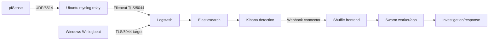

# Kiến trúc hệ thống DATN

## 1. Mục tiêu kiến trúc

Hệ thống được thiết kế theo mô hình lab SOC, tách các chức năng thu thập log, phát hiện, mô phỏng tấn công và phản ứng tự động.

## 2. Thành phần

### ELK Stack

- **Elasticsearch:** lưu trữ và tìm kiếm log.
- **Logstash:** xử lý, chuẩn hóa và chuyển tiếp dữ liệu khi cần.
- **Kibana:** truy vấn, dashboard và hỗ trợ điều tra.

### Sigma

Sigma được dùng làm định dạng rule phát hiện độc lập với SIEM. Rule sẽ được ánh xạ với kỹ thuật MITRE ATT&CK tương ứng.

### Atomic Red Team

Atomic Red Team tạo các hành vi kiểm thử có kiểm soát trên máy lab để kiểm tra khả năng sinh log và phát hiện.

Chỉ thực hiện trên máy hoặc môi trường được phép kiểm thử.

### Shuffle SOAR

Shuffle nhận alert hoặc sự kiện từ lớp detection và thực thi workflow phản ứng tự động.

Ví dụ:

```text
Alert
  |
  v
Shuffle Workflow
  |
  +--> Enrichment
  +--> Notify
  +--> Create Case
  +--> Response Action
```

## 3. Luồng dữ liệu thực tế



Ngoại lệ tạm thời đang được nhóm chấp nhận:

```text
[Windows của Bình / Winlogbeat] --+
                                  +--> Elasticsearch 9200/TCP --> Kibana
[Linux của Bình / Auditbeat] -----+
```

Đường trực tiếp không qua filter của Logstash. Chỉ whitelist đúng địa chỉ nguồn `/32`; không mở `9200/TCP` cho toàn Internet.

ELK và Shuffle dùng bridge ngoài `elk-shuffle-integration`; Kibana gọi Shuffle bằng hostname nội bộ `shuffle-frontend`. Shuffle runtime chạy trên Docker Swarm overlay `shuffle_swarm_executions`. Xem địa chỉ, port, account/key inventory và sơ đồ chi tiết trong [tài liệu cấu hình hợp nhất ngày 22/10/2026](2026-10-22_configuration-inventory-and-network-guide.md).

## 4. Mô hình triển khai hai thành viên

Server trung tâm có thể chạy trên VM/cloud:

- Elasticsearch
- Kibana
- Logstash (nếu sử dụng)
- Shuffle
- Kho rule Sigma

Hai thành viên sử dụng máy local/VM để:

- tạo endpoint Windows/Linux,
- sinh log,
- chạy Atomic Red Team,
- kiểm thử detection,
- thu thập evidence.

## 5. Mục tiêu đánh giá

Mỗi test case nên ghi tối thiểu:

| Thuộc tính | Nội dung |
|---|---|
| Technique | MITRE ATT&CK Technique ID |
| Test | Atomic test hoặc hành vi tương đương |
| Log Source | Nguồn log quan sát được |
| Detection | Rule Sigma |
| Alert | Có/Không |
| Response | Manual/Automated |
| Detection Time | Thời gian phát hiện |
| Response Time | Thời gian phản ứng |
| Evidence | Screenshot / log / JSON |

## 6. Nguyên tắc

Hệ thống phục vụ nghiên cứu và kiểm thử trong môi trường được cấp quyền. Không chạy các bài mô phỏng trên hệ thống sản xuất hoặc máy không thuộc phạm vi đồ án.
