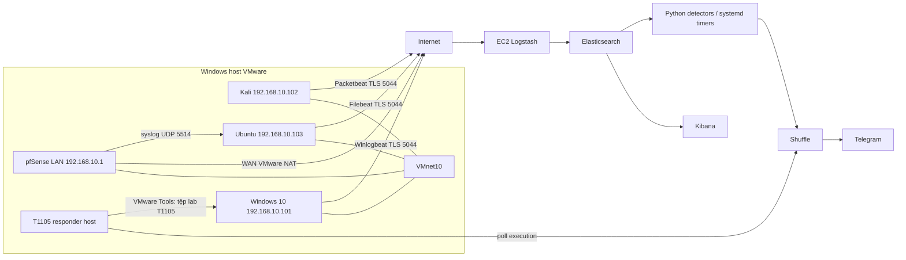

# Kiến trúc và sơ đồ mạng DATN

## Thành phần và phạm vi

Lab dùng VMware Workstation trên Windows host, pfSense làm gateway, endpoint Windows/Ubuntu và Kali. AWS EC2 chạy Elasticsearch, Logstash, Kibana và Shuffle. Vào 04/11/2026, Elastic security được xác nhận bật trên container live; các timer PB01, PB04, T1059 và T1105 báo active. Đây là ảnh chụp tại thời điểm kiểm tra.

Trên cùng VMnet10, Kali và Ubuntu/Windows có thể liên lạc trực tiếp; pfSense không chắc nằm trên đường dữ liệu nội bộ. Không tuyên bố rule pfSense chặn được lưu lượng cùng subnet khi chưa kiểm tra topology. Internet và địa chỉ EC2 có thể đổi; kiểm tra VMX, `ipconfig`, `ip route`, DHCP và AWS Console trước khi cấu hình.

## Thành phần

| Thành phần | Vai trò | Thông tin đã ghi nhận |
|---|---|---|
| pfSense | WAN NAT, LAN, DNS Resolver, syslog | LAN `192.168.10.1`, WAN VMware NAT |
| Windows 10 Client | Sysmon, PowerShell logging, Winlogbeat, Atomic T1059/T1105 | `192.168.10.101`, hostname `DESKTOP-2FV6M9C` |
| Kali | Atomic và Packetbeat DNS; HTTP marker T1105 | `192.168.10.102`, VMnet10 |
| Ubuntu Server | web lab, SSH, Filebeat và pfSense syslog relay | `192.168.10.103`, `prod-web-01` |
| EC2 | ELK/Shuffle và Python detector | public IP ghi nhận `18.139.50.205`, xác nhận lại trước dùng |
| Windows host | VMware Tools và T1105 responder | task `DATN-T1105-Responder`, cần user đăng nhập |

## Cổng và luồng

| Nguồn → đích | Cổng | Mục đích |
|---|---|---|
| pfSense → Ubuntu | UDP 5514 | syslog relay |
| Filebeat/Winlogbeat/Packetbeat → EC2 | TCP 5044, TLS | Beats đến Logstash |
| quản trị → EC2 | TCP 22, 5601, 3001 | SSH, Kibana, Shuffle |
| Windows lab → Kali | TCP 8088 | marker T1105 lab |
| detector → Elasticsearch | HTTPS 9200 nội bộ EC2 | tìm kiếm bằng API key giới hạn |
| detector → Shuffle → Telegram | webhook / HTTPS bot API | workflow và thông báo |

Ảnh Security Group trước đây cho phép 22/3001/5044/5601 từ mọi IPv4. Đây là ảnh lịch sử, không chứng minh chính sách AWS hiện tại; kiểm tra lại và thu hẹp nguồn theo địa chỉ cần dùng khi triển khai.

## Lưu ý kiến trúc

Sigma là định dạng rule; PB01/PB04/T1059/T1105 trong lab thực tế dùng detector Python có timer, không phải Elastic Detection Rule đã chuyển đổi từ Sigma. T1046 trong báo cáo 31/10 gọi webhook thủ công sau đối chiếu log. T1105 chuyển tệp qua responder host sau execution Shuffle; không phải action quarantine trực tiếp trong Shuffle. Các giới hạn và evidence chi tiết ở [nghiệm thu](chi-tiet/03-detection-soar-nghiem-thu.md).
