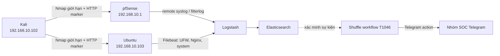

# Hướng dẫn và báo cáo kiểm thử MITRE ATT&CK T1046 với pfSense, Ubuntu và Shuffle

> **Phạm vi an toàn:** bài kiểm thử chỉ thực hiện trong lab được cấp quyền, dùng danh sách cổng giới hạn. Không dùng quy trình này để quét hệ thống bên ngoài khi chưa có văn bản cho phép.
>
> **Cảnh báo bí mật:** workflow Telegram nguồn đang lưu bot token trong tham số action và kết quả kỹ thuật của Shuffle có thể trả lại URL chứa token. Tài liệu này đã che toàn bộ token/mật khẩu. Cần xoay bot token sau bài test và chuyển sang authentication/secret của Shuffle.

## 1. Kết quả

Kiểm thử **thành công** vào ngày 31/10/2026:

- Ba VM pfSense, Ubuntu Server và Kali Linux đã được bật lại và xác nhận đang chạy bằng `vmrun list`.
- Kali `192.168.10.102` quét giới hạn pfSense `192.168.10.1` và Ubuntu `192.168.10.103` theo MITRE ATT&CK **T1046 – Network Service Scanning**.
- Ubuntu ghi nhận các gói bị UFW chặn tới TCP/443, TCP/8000, TCP/5514 và HTTP marker trả mã 404.
- pfSense ghi nhận lưu lượng TCP/443 bị chặn trên WAN trong `filterlog`.
- Đã dựng thêm workflow Shuffle **T1046 Network Service Scanning - pfSense and Ubuntu**.
- Workflow ID: `ea1c4941-8b6a-4069-b686-095a050aa585`.
- Execution ID: `c540c818-3e92-4e4d-87b6-6461e7b1852f`.
- Trạng thái cuối: `FINISHED`; action `Telegram_T1046_Alert`: `SUCCESS`; Telegram API: HTTP `200`, `ok=true`.
- Test ID xuyên suốt: `DATN_T1046_20261031T001000_ICT`.

Việc tạo/lưu workflow và tạo webhook dùng các endpoint chính thức của [Shuffle Workflow API](https://github.com/shuffle/shuffle-docs/blob/master/docs/API.md).

## 2. Kiến trúc và luồng kiểm thử



Đường nét đứt thể hiện bước hiện tại là **xác minh log rồi POST webhook thủ công**. Chưa triển khai rule/connector tự động từ Elasticsearch sang Shuffle.

## 3. Thành phần lab

| Thành phần | Vai trò | Địa chỉ dùng trong test |
|---|---|---|
| Kali Linux | Máy phát hành vi T1046 | `192.168.10.102` |
| pfSense | Firewall và nguồn `filterlog` | LAN `192.168.10.1`; WAN `192.168.173.132` |
| Ubuntu Server | Web server, UFW và nguồn log | `192.168.10.103` |
| ELK/Shuffle | Thu thập log và SOAR | `<ELK_SHUFFLE_HOST>` |

Các file hỗ trợ trong workspace:

- Script kiểm thử: [`../work/run-t1046-lab-test.sh`](../work/run-t1046-lab-test.sh)
- Kết quả Nmap: [`../work/t1046-kali-test-output.txt`](../work/t1046-kali-test-output.txt)
- Trạng thái mạng Kali: [`../work/kali-network-current.txt`](../work/kali-network-current.txt)
- Script dựng workflow: [`../work/create-t1046-shuffle-workflow.ps1`](../work/create-t1046-shuffle-workflow.ps1)

## 4. Cách chạy lại

### 4.1. Bật VM

Chạy PowerShell trên máy Windows có VMware Workstation:

```powershell
$vmrun = 'C:\Program Files (x86)\VMware\VMware Workstation\vmrun.exe'
& $vmrun start '<PFSENSE_VMX_PATH>' nogui
& $vmrun start '<UBUNTU_VMX_PATH>' nogui
& $vmrun start '<KALI_VMX_PATH>' nogui
& $vmrun list
```

Kết quả mong đợi: `Total running VMs: 3`.

### 4.2. Chạy T1046 từ Kali

Script chỉ quét các cổng đã định nghĩa, không quét toàn dải:

```bash
chmod +x /tmp/run-t1046-lab-test.sh
/tmp/run-t1046-lab-test.sh | tee /tmp/t1046-kali-test-output.txt
```

Các lệnh chính có thể chạy thủ công:

```bash
nmap -sT -Pn -n --reason -p 22,53,80,443,5514 192.168.10.1
nmap -sT -Pn -n --reason -p 22,80,443,5514,8000 192.168.10.103
curl --max-time 10 -sS -o /dev/null -w 'ubuntu_http=%{http_code}\n' \
  http://192.168.10.103/DATN_T1046_20261031T001000_ICT
```

Kết quả đã quan sát:

- pfSense: TCP/53 và TCP/80 mở; TCP/22, TCP/443, TCP/5514 bị lọc.
- Ubuntu: TCP/22 và TCP/80 mở; TCP/443, TCP/5514, TCP/8000 bị lọc.
- HTTP marker trên Ubuntu trả `404`; đây vẫn là bằng chứng truy cập vì request xuất hiện trong Nginx/Gunicorn log.

### 4.3. Dựng workflow Shuffle

Không ghi mật khẩu vào dòng lệnh. Script hiện đọc credential từ file private cục bộ:

```powershell
& 'D:\DATN\work\create-t1046-shuffle-workflow.ps1' `
  -ShuffleBaseUrl '<SHUFFLE_BASE_URL>' `
  -CredentialFile '<PRIVATE_CREDENTIAL_FILE>'
```

Script thực hiện đăng nhập, tạo workflow, sao chép action Telegram đã cấu hình, đổi message template cho T1046, lưu workflow và tạo webhook. Kết quả mong đợi gồm `save_success=true` và `hook_success=true`.

### 4.4. Kích hoạt playbook

```powershell
$payload = @{
  technique = 'T1046'
  source = 'pfSense filterlog + Ubuntu UFW/Nginx'
  source_ip = '192.168.173.1; 192.168.10.102'
  target = 'pfSense WAN 192.168.173.132; Ubuntu 192.168.10.103'
  ports = '443, 8000, 5514, HTTP marker'
  test_id = 'DATN_T1046_20261031T001000_ICT'
  status = 'VERIFIED_BY_LOGSTASH'
} | ConvertTo-Json -Compress

Invoke-RestMethod -Method Post `
  -Uri '<SHUFFLE_WEBHOOK_URL>' `
  -ContentType 'application/json' `
  -Body $payload
```

Phản hồi đã nhận:

```json
{
  "success": true,
  "execution_id": "c540c818-3e92-4e4d-87b6-6461e7b1852f"
}
```

## 5. Evidence → Finding → Path

### Evidence

**E-001 – VM và kết nối mạng**

- `vmrun list` sau khi bật lại: 3 VM đang chạy.
- Kali có `eth0 192.168.10.102/24`, gateway `192.168.10.1`.
- Ping pfSense và Ubuntu đều thành công, mất gói `0%`.
- Nguồn: `work/kali-network-current.txt` và kiểm tra trực tiếp ngày 31/10/2026.

**E-002 – Kết quả quét giới hạn từ Kali**

- Nmap phát hiện dịch vụ DNS/HTTP trên pfSense và SSH/HTTP trên Ubuntu.
- Các cổng 443, 5514, 8000 bị lọc đúng theo chính sách firewall.
- Nguồn: `work/t1046-kali-test-output.txt`.

**E-003 – Log Ubuntu qua Logstash**

Logstash ghi nhận:

```text
[UFW BLOCK] SRC=192.168.10.102 DST=192.168.10.103 PROTO=TCP DPT=443
[UFW BLOCK] SRC=192.168.10.102 DST=192.168.10.103 PROTO=TCP DPT=8000
[UFW BLOCK] SRC=192.168.10.102 DST=192.168.10.103 PROTO=TCP DPT=5514
192.168.10.102 ... "GET /DATN_T1046_20261031T001000_ICT HTTP/1.1" 404
```

Thời gian log ứng dụng: khoảng `2026-10-30 17:07:30 UTC`, tương ứng `2026-10-31 00:07:30 ICT`.

**E-004 – Log pfSense qua Logstash**

```text
Oct 31 00:07:26 filterlog: em0,match,block,in,...,
192.168.173.1,192.168.173.132,33708,443,...,S
```

Đây là probe TCP/443 từ phía WAN host tới pfSense. Nó xác nhận đường thu thập `pfSense filterlog → Logstash`, nhưng không phải gói từ Kali LAN.

**E-005 – Shuffle và Telegram**

- Workflow ID: `ea1c4941-8b6a-4069-b686-095a050aa585`.
- Execution ID: `c540c818-3e92-4e4d-87b6-6461e7b1852f`.
- Workflow: `FINISHED`.
- Action `Telegram_T1046_Alert`: `SUCCESS`.
- Telegram: HTTP `200`, `ok=true`; message chứa đúng Test ID và các trường nguồn log, source IP, target, port, trạng thái.
- Token, chat ID và URL chứa token đã bị loại khỏi tài liệu.

### Findings

**F-001 – T1046 được quan sát và playbook cảnh báo hoạt động (Informational/Pass)**

E-002 chứng minh hoạt động dò dịch vụ; E-003 và E-004 chứng minh telemetry từ Ubuntu/pfSense tới Logstash; E-005 chứng minh Shuffle chuyển dữ liệu đã xác minh thành cảnh báo Telegram thành công.

**F-002 – Bot token có nguy cơ lộ qua cấu hình/kết quả execution (High)**

Action nguồn lưu token trực tiếp và raw execution result có URL API chứa token. Người có quyền đọc workflow/execution có thể lấy token và gửi tin giả. Khắc phục: xoay token với BotFather, thu hồi token cũ, lưu token trong Authentication/secret của Shuffle, giới hạn quyền đọc execution và không log raw URL.

**F-003 – Tài khoản Logstash không có quyền đọc để truy vấn xác minh (Low/Operational)**

Tài khoản `logstash` ghi dữ liệu được nhưng truy vấn đọc trả HTTP `403`. Lần test này dùng stdout của Logstash làm bằng chứng. Nên tạo tài khoản chỉ đọc riêng cho kiểm thử/triage, không tăng quyền tài khoản ingest.

**F-004 – Chưa tự động hóa đường Elastic → Shuffle (Medium/Gap)**

Webhook được POST thủ công sau khi đối chiếu log. Vì vậy kết quả xác nhận action SOAR/Telegram, nhưng chưa chứng minh detection rule tự kích hoạt playbook. Bước tiếp theo là tạo Elastic detection/alert connector gọi webhook khi điều kiện T1046 thỏa mãn.

### Paths

**P-001 – Chuỗi phát hiện và phản ứng đã kiểm chứng**

```text
Kali T1046
  → pfSense/Ubuntu quan sát lưu lượng
  → Filebeat/remote syslog
  → Logstash
  → người kiểm thử xác minh E-003/E-004
  → Shuffle webhook
  → Telegram action HTTP 200
```

Liên kết bằng chứng: `E-002 → E-003/E-004 → E-005`, hỗ trợ finding `F-001`.

**P-002 – Đường rủi ro bí mật**

```text
Người dùng có quyền đọc execution
  → xem raw result
  → lấy URL chứa bot token
  → có khả năng gửi tin nhắn trái phép
```

Liên kết bằng chứng: hành vi raw result trong E-005 hỗ trợ finding `F-002`; giá trị bí mật không được chép vào báo cáo.

## 6. Tiêu chí pass/fail

| Tiêu chí | Kết quả |
|---|---|
| Ba VM khởi động | PASS |
| Kali tới pfSense/Ubuntu có kết nối | PASS |
| Tạo được hành vi T1046 giới hạn | PASS |
| Ubuntu log nhận source `192.168.10.102` | PASS |
| pfSense `filterlog` tới Logstash | PASS |
| Tạo và lưu workflow Shuffle mới | PASS |
| Webhook tạo execution | PASS |
| Telegram action thành công | PASS |
| Elastic tự động gọi Shuffle | NOT IMPLEMENTED |

## 7. Giới hạn và lưu ý

- UDP marker gửi tới Ubuntu/5514 bị UFW chặn; không được dùng làm bằng chứng marker đã tới syslog receiver.
- Bằng chứng pfSense là probe trên WAN từ host `192.168.173.1`, còn bằng chứng Ubuntu là scan T1046 từ Kali `192.168.10.102`.
- Truy vấn trực tiếp Elasticsearch bằng tài khoản ingest không thực hiện được do thiếu quyền đọc; stdout Logstash là nguồn bằng chứng trong lần chạy này.
- Thời gian VM Kali hiển thị EDT trong output Nmap, trong khi log máy chủ dùng UTC/ICT. Test ID được dùng để tương quan thay vì chỉ dựa vào timezone.
- Workflow Telegram kế thừa action từ playbook cũ. Phải xoay token trước khi xem đây là cấu hình production.

## 8. Khắc phục sự cố

### Shuffle trả 502

Trong lần chạy này, OpenSearch khởi động chậm khiến backend Shuffle chưa lắng nghe. Chờ OpenSearch hoàn tất, xác nhận API chưa đăng nhập trả `401` thay vì `502`, rồi chạy lại script. Không tạo workflow lặp nếu tên đã tồn tại; script tái sử dụng workflow cùng tên.

### Telegram không ra tin nhắn

Kiểm tra theo thứ tự:

1. Execution có được tạo và kết thúc `FINISHED` không.
2. Action có `SUCCESS` và Telegram trả HTTP `200`, `ok=true` không.
3. Template dùng đúng các trường JSON: `source`, `source_ip`, `target`, `ports`, `test_id`, `status`.
4. Bot còn trong nhóm, có quyền gửi tin và chat ID thuộc đúng nhóm.
5. Token còn hiệu lực; nếu từng lộ trong log/execution thì phải xoay token và cập nhật Authentication của Shuffle.

## 9. Bước nâng cấp đề xuất

1. Xoay Telegram bot token ngay và chuyển khỏi plaintext parameter.
2. Tạo Elastic detection rule cho nhiều kết nối bị chặn/dò cổng trong cửa sổ thời gian ngắn.
3. Dùng connector/webhook tự động gọi workflow T1046.
4. Tạo service account chỉ đọc phục vụ truy vấn xác minh và dashboard.
5. Chạy lại cùng Test ID mới và yêu cầu chuỗi hoàn toàn tự động đạt PASS.
